


 


  


  <a href="https://github.com/TanyaChhikara/RegDelta-Regulatory-Change-Impact-Analyzer"></a>
  <a href="https://github.com/TanyaChhikara/Detecting_Social_and_Politicla_Bias_in_Hindi_Media"></a>
  <a href="https://github.com/TanyaChhikara/Auto_Encoders_for_Crowd_Density_Estimation"></a>
  <a href="https://github.com/TanyaChhikara/TriNayan"></a>

 

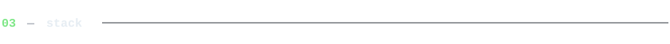

  
  

  


  

